<!-- animated contribution graph: real data, boxes reveal cell by cell
     (regenerated daily by .github/workflows/update-profile-art.yml) -->

<h3><code>neva@github ~ $ ./contributions.sh</code></h3>

 
 

<!-- ascii portrait (left) + neofetch-style info card (right). both svgs are
     840x880 so equal widths give equal heights.
     portrait:  python scripts/prep_photo.py && python scripts/make_ascii_svg.py
     info card: edit ROWS in scripts/make_info_card.py, then python scripts/make_info_card.py -->

<h3><code>neva@github ~ $ whoami</code></h3>

<table>
<tr>
<td valign="top"></td>
<td valign="top"></td>
</tr>
</table>

 
 

<h3><code>neva@github ~ $ cat about.txt</code></h3>

<b>Computer Engineer · Computer Vision · NLP · Data Science</b>

I build things that see, listen and read: camera-driven trainers, gesture instruments, 
NLP benchmarks, customer analytics pipelines... and many more!

 
 

<h3><code>neva@github ~ $ ls -la projects/</code></h3>

<table>
<tr>
<td valign="top" width="50%">
<b><a href="https://github.com/nevaerdogan/FootworkCoach">FootworkCoach</a></b> · <a href="https://footworkcoach.pages.dev">live</a> 
Browser-based kickboxing footwork trainer. Watch a drill, perform it in front of your camera, get a breakdown of direction, distance, timing and rhythm. Runs fully on-device. 
<code>TypeScript</code> <code>React</code> <code>MediaPipe</code>
</td>
<td valign="top" width="50%">
<b><a href="https://github.com/nevaerdogan/Hand-Gesture-Music">Hand-Gesture-Music</a></b> 
Touchless musical instrument controlled by hand gestures via webcam. Chords are synthesized live from sine waves and ADSR envelopes, no pre-recorded audio. 
<code>Python</code> <code>OpenCV</code> <code>MediaPipe</code>
</td>
</tr>
<tr>
<td valign="top" width="50%">
<b><a href="https://github.com/nevaerdogan/TRNewsSummarizer">TRNewsSummarizer</a></b> · <a href="https://trnewssummarizer.streamlit.app/">live</a> 
Systematic benchmark of 10 extractive summarization methods for Turkish news: TF-IDF, TextRank, LSA, NMF, sentence embeddings and quantum-inspired clustering. 
<code>Python</code> <code>NLP</code> <code>Streamlit</code>
</td>
<td valign="top" width="50%">
<b><a href="https://github.com/nevaerdogan/text-mining-for-authorship-detection">text-mining-for-authorship-detection</a></b> 
Authorship classification for Turkish documents using TF-IDF, n-grams and BERT embeddings with ensemble models. 
<code>Python</code> <code>NLP</code> <code>BERT</code>
</td>
</tr>
<tr>
<td valign="top" width="50%">
<b><a href="https://github.com/nevaerdogan/Customer_Lifetime_Value_Prediction">Customer_Lifetime_Value_Prediction</a></b> 
CLTV prediction with BG-NBD and Gamma-Gamma probabilistic models to forecast customer value and guide marketing spend. 
<code>Python</code> <code>pandas</code>
</td>
<td valign="top" width="50%">
<b><a href="https://github.com/nevaerdogan/Customer_Segmentation_with_RFM">Customer_Segmentation_with_RFM</a></b> 
End-to-end RFM customer segmentation pipeline: preprocessing, metric calculation, scoring and target-group identification for campaigns. 
<code>Python</code> <code>pandas</code>
</td>
</tr>
</table>

 
 

<h3><code>neva@github ~ $ ./links.sh</code></h3>

 

